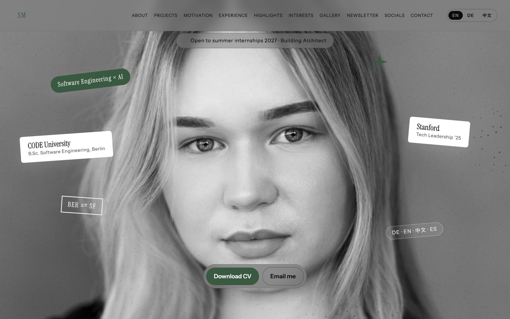
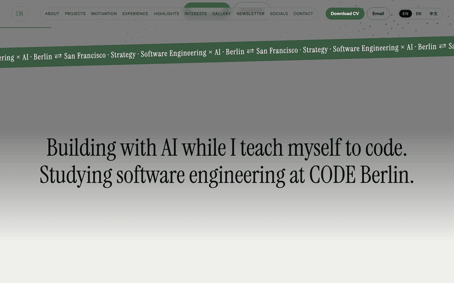
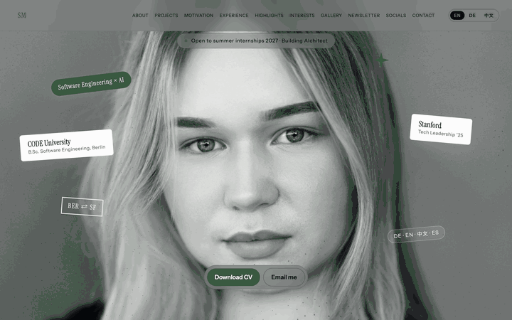

<div align="center">

# Selina Meusel · Personal Website

My personal portfolio website, in three languages.

[](https://selinameusel.com)
[-22c55e?style=for-the-badge)](https://selinameusel.com/assets/Selina_Meusel_CV.pdf)


<a href="https://selinameusel.com"></a>

</div>

## Features

- **Trilingual:** English, German and Chinese, switchable at any time (`translations.js`)
- **Portfolio** with projects, experience and an AI agents section
- **Newsletter** with an issue archive (`newsletter-issues.js`, `issues/`)
- **Interactive details** like a spotlight cursor, scroll animations, animated counters and a live, clickable Vibolingo demo inside a phone frame
- **CV download** right from the hero section

## Three languages, one click



## A quick scroll through



## Pages

| File | Page |
|---|---|
| `Selina Portfolio.dc.html` | Main portfolio |
| `Agents.dc.html` | AI agents |
| `Newsletter.dc.html` | Newsletter |
| `index.html` | Redirects to the main portfolio |

## Run locally

The pages load their components at runtime, so they need a small web server (opening the files directly does not work):

```bash
git clone https://github.com/meuselina/My-personal-website-and-CV.git
cd My-personal-website-and-CV
python3 -m http.server 8000
```

Then open http://localhost:8000.

## Built with

HTML, CSS, JavaScript · hosted on Cloudflare Pages · custom domain [selinameusel.com](https://selinameusel.com)

## Rights

Photos, texts and the CV are © 2026 Selina Meusel. Please don't reuse them without asking.
